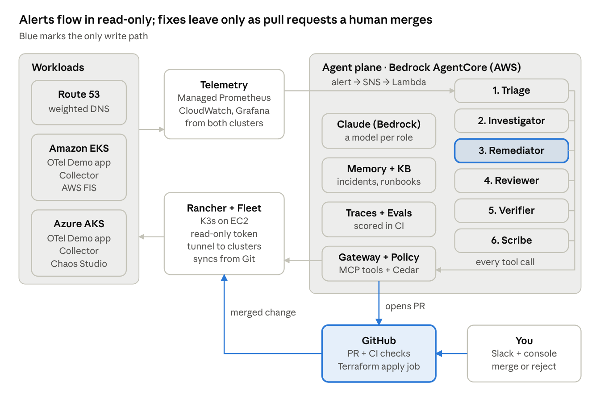

# Multi-Cloud Agentic SRE

An open, evaluated SRE agent system on AWS. It investigates incidents across Amazon EKS and Azure AKS, proposes every fix as a pull request that a human merges, and then verifies that the fix worked.

## Status

Current phase: **1, Foundation on AWS**. Phase 0 closed on 2026-11-14. Full plan: [docs/plan.md](docs/plan.md).

| Phase | Goal | Gate |
| --- | --- | --- |
| 0. Inception and spikes | Requirements approved; Rancher MCP and cross-cloud identity proven | 2026-11-29 |
| 1. Foundation on AWS | EKS, Rancher + Fleet, telemetry, first alert | 2026-12-13 |
| 2. Agent prototype, read-only | Correct root cause on 3 EKS scenarios | 2026-12-23 |
| 3. Closed-loop remediation | Fix by PR, human merge, verified recovery | 2027-01-17 |
| 4. Evaluation harness | Baseline scorecard v0 in CI | 2027-01-31 |
| 5. Multi-cloud | AKS joined; all 15 scenarios; gray failures handled | 2027-02-14 |
| 6. Multi-agent, memory, governance | Full agent graph; OWASP agentic controls | 2027-02-28 |
| 7. Console, benchmark, release | v1.0 with its evidence pack | 2027-03-14 |

## How it's built

The project follows AWS's AI-Driven Development Lifecycle (AI-DLC), run with [awslabs/aidlc-workflows](https://github.com/awslabs/aidlc-workflows) in Claude Code. Every step leaves evidence:

- AI-DLC records (requirements, designs, approvals, audit trail) in `aidlc/`
- Architecture decisions in `docs/adr/`
- Guardrail logs, rulesets, telemetry and reports in `docs/evidence/`
- An "AI involvement" section in every pull request, checked by CI

## Repository map

| Path | Contents |
| --- | --- |
| `infra/` | Terraform for AWS and Azure |
| `platform/` | Fleet bundles: demo app, flag settings, collectors (agent PRs land here) |
| `agents/` | Strands agent graph, prompts, tools, Cedar policies |
| `evals/` | Scenarios, replays, evaluators, scorecards |
| `console/` | React/Vite approval console |
| `aidlc/` | AI-DLC records, created by aidlc-workflows |
| `docs/` | Plan, ADRs, runbooks, diagrams, evidence |
| `tools/` | Claude Code guardrail hooks, CI checks, local collector config, spike manifests |

## Getting started

Follow [docs/runbooks/phase-0.md](docs/runbooks/phase-0.md).
