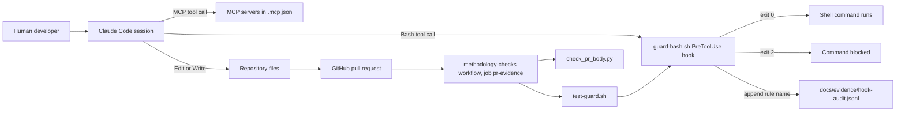
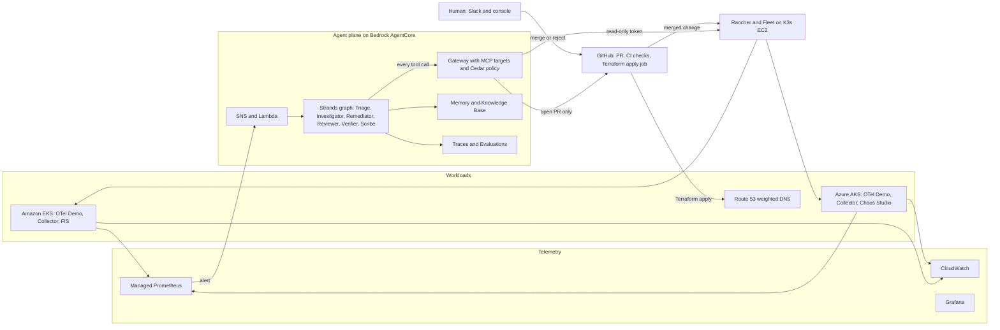
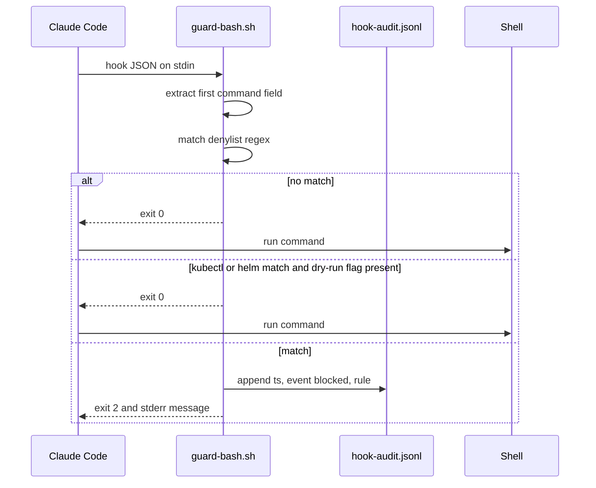
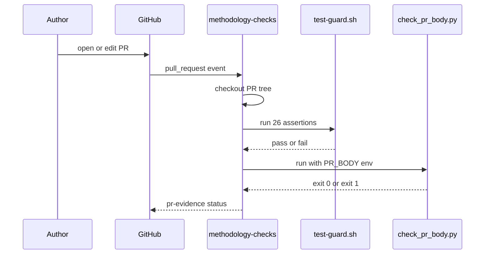
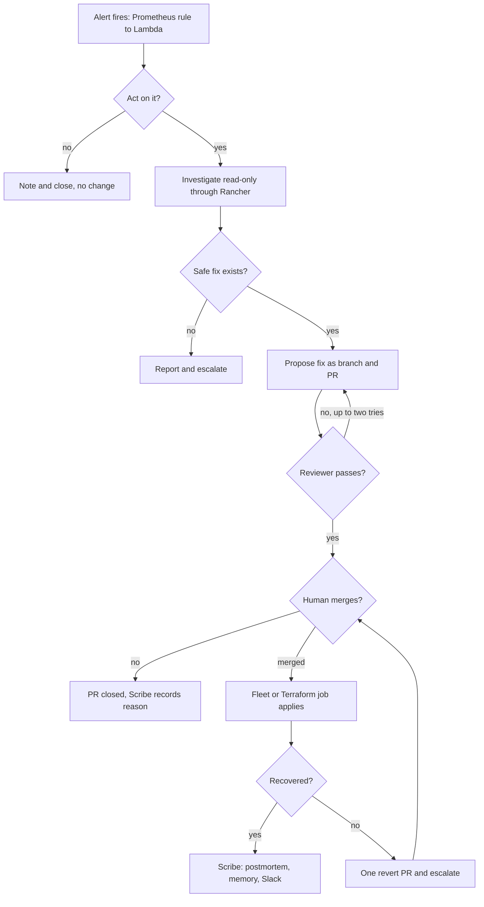

# Architecture

## Architecture Analysis

### System Overview

Two architectures must be kept apart:

1. **As built (commit 69ec4cd)**: a development-governance scaffold. The only executable parts are a Claude Code PreToolUse hook (`tools/claude-hooks/guard-bash.sh`), its Bash test script, a Python PR-description check (`tools/ci/check_pr_body.py`) and one GitHub Actions workflow (`methodology-checks`) that runs both. Everything else is documentation, spike fixtures and placeholder folders.
2. **As planned (`docs/plan.md`, `docs/diagrams/architecture.png`)**: an event-driven agent system on AWS. Alerts from EKS and AKS enter through Managed Prometheus -> SNS -> Lambda; a fixed Strands graph of six agents runs in AgentCore Runtime; every tool call goes through AgentCore Gateway with Cedar policies; the only write path is a GitHub PR, which a human merges and Fleet or a Terraform job applies.

### Architectural Style

- **As built**: script-based tooling around a Git repository (hook + CI check). No services.
- **As planned**: event-driven, serverless-leaning hybrid. Managed agent runtime (AgentCore) with a fixed agent graph, a governed tool gateway, GitOps (Fleet) for Kubernetes state and a Terraform pipeline for cloud state ("two GitOps loops"). Evidence: `docs/plan.md` sections "Components", "Agent design", "Multi-cloud design".

### Component Relationships

As built: the development guardrail and CI gate.

<!-- Text fallback: Human developer -> Claude Code session. Bash tool calls go through guard-bash.sh (exit 0 runs, exit 2 blocks and appends the rule name to docs/evidence/hook-audit.jsonl). MCP tool calls and Edit/Write calls do NOT pass through the project's hook. Edited files reach a GitHub PR; the methodology-checks workflow (job pr-evidence) runs test-guard.sh (which exercises guard-bash.sh) and check_pr_body.py. -->

As planned: target runtime (from `docs/plan.md` and `docs/diagrams/architecture.png`; nothing below exists yet).

<!-- Text fallback: EKS and AKS send telemetry to Managed Prometheus and CloudWatch (Grafana on top). An alert goes SNS -> Lambda -> the Strands agent graph in AgentCore Runtime. Every agent tool call goes through AgentCore Gateway (MCP targets, Cedar policy). The Gateway reads clusters through Rancher with a read-only token and can only open PRs on GitHub. A human merges or rejects; merged changes reach clusters through Fleet (via Rancher) and cloud resources such as Route 53 weights through a Terraform apply job. -->

### Data Flow

- **As built**:
  - Hook input: Claude Code writes the tool-call JSON to the hook's stdin; the script extracts the first `"command"` field with `grep -Eo` and matches it against a regex denylist. Output: exit code, stderr message, and on a block one JSON line `{"ts","event":"blocked","rule"}` to `docs/evidence/hook-audit.jsonl` (rule = first two words of the match, never the full command).
  - PR check: GitHub passes the PR body to the job as env `PR_BODY`; the script strips HTML comments and searches line-anchored labels. No data is persisted.
- **As planned**: telemetry -> alert -> incident record (DynamoDB with conditional writes) -> agent session -> tool calls through Gateway -> PR on GitHub -> human merge -> Fleet or Terraform apply -> merge webhook -> Verifier session -> Scribe writes memory and postmortem.

### Key Design Decisions

| Decision | Where recorded | Status | Implication |
| --- | --- | --- | --- |
| Adopt AI-DLC in Claude Code; plan is input, not requirements | ADR-0001 | Proposed | Requirements must come out of Inception |
| Enforce dev guardrails with a PreToolUse hook | ADR-0001 | Proposed | Guard is a Bash-only denylist today |
| Hook fails closed (`onFailure: block`) and a human installs it | ADR-0004 | Proposed | A broken guard blocks every Bash call, including `aidlc engine` commands; re-running `aidlc config --harness claude` silently drops the guard |
| Writes only through PRs; human merge is the only production gate | plan "Safety", diagrams | Planned | Agents get read-only Kubernetes access and a GitHub App limited to contents and PRs |
| Rancher as the single Kubernetes path for both clouds | plan "Why Rancher" | Planned, spike A pending | Fallback: generic Kubernetes MCP server with a Rancher-generated kubeconfig |
| AKS-to-AWS identity by workload identity federation | plan "Multi-cloud design" | Planned, spike B pending | No static keys; ADR-0003 to record outcome |
| Fixed agent graph rather than a swarm | plan "Agent design" | Planned | Easier to test, trace and bound |
| Reviewer uses a different model from the Remediator | plan "Agent design" | Planned | Opus 4.6 reviewer vs Sonnet 4.6 remediator |

### Improvement Opportunities

1. **Extend guard coverage beyond Bash.** Add PreToolUse matchers for MCP tools (`mcp__.*`) and for Edit/Write on protected paths (`.mcp.json`, `.claude/settings.json`, `.github/`, `tools/claude-hooks/`, `tools/ci/`). The intent explicitly requires both.
2. **Move protection of the gates outside the PR.** `CODEOWNERS` for the protected paths plus a ruleset requiring code-owner review, so a PR cannot weaken the check that judges it.
3. **Make read-only credentials the default for the coding agent.** A separate read-only AWS profile (for example `ReadOnlyAccess` or `ViewOnlyAccess` permission set) exported in the shell Claude Code starts from; admin only in a human terminal.
4. **Harden the denylist parser.** Match verbs after global flags, scope the `--dry-run` exemption to the matched segment, add `gh` writes, force refspecs and other AWS mutating verbs; treat the list as defense in depth, not the primary control.
5. **Pin by digest.** Images (`amazon/aws-cli`, collector) and actions (`actions/checkout`) by digest or SHA, matching the plan's ASI04 control.
6. **Add linting and Python tests** (Ruff, pytest, ShellCheck) to CI before Phase 2 code lands, to meet the classic-scope 80% coverage floor.

## Interaction Diagrams

### 1. Coding agent Bash call through the guard hook (as built)

<!-- Text fallback: Claude Code sends the hook JSON to guard-bash.sh, which extracts the first command field and matches it against the denylist. No match: exit 0 and the command runs. A kubectl/helm match with "--dry-run" anywhere in the command: exit 0 and the whole command runs. Any other match: the script appends {ts, event: blocked, rule} to docs/evidence/hook-audit.jsonl and exits 2 with a message, so the command is blocked. If the script itself fails, onFailure: block also blocks the call. -->

### 2. Pull request methodology check (as built)

<!-- Text fallback: The author opens or edits a PR; GitHub triggers the methodology-checks workflow on the pull_request event. The job checks out the PR's own tree, runs test-guard.sh (26 assertions) and then check_pr_body.py with the PR body in the PR_BODY environment variable. The job result becomes the pr-evidence status, which the runbook makes a required check after the first PR. -->

### 3. Incident lifecycle (planned)

<!-- Text fallback: Alert -> Triage decides whether to act (no: note and close). Investigator works read-only through Rancher; if no safe fix exists, report and escalate. Otherwise Remediator opens a PR; Reviewer either passes it or sends it back (two tries, then escalate). Human merges or closes (Scribe records the reason). After merge, Fleet or the Terraform job applies; Verifier checks recovery: yes -> Scribe writes postmortem, memory, Slack; no -> one revert PR (needs a human merge) and escalation. -->
