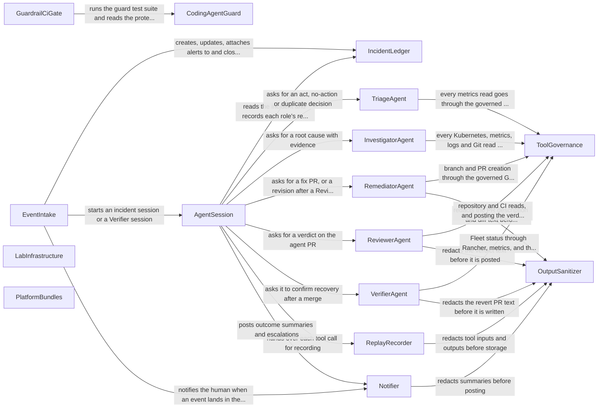

# Components: Multi-Cloud Agentic SRE, Phases 1 to 3

Logical building blocks (code we write) for Phases 1 to 3. Inputs:
- the approved requirements in `inception/requirements-analysis/requirements.md`;
- the stories in `inception/user-stories/stories.md`;
- the as-built and planned architecture in `aidlc/spaces/default/codekb/multi_cloud_agentic_SRE/architecture.md`;
- the existing components in `aidlc/spaces/default/codekb/multi_cloud_agentic_SRE/component-inventory.md`;
- the affirmed practices in `inception/practices-discovery/team-practices.md`.

Boundary choices come from `domain-design-questions.md` (Q1 to Q6) and are recorded as ADRs in `decisions.md`. Infrastructure and managed services are listed as external dependencies, never as components. Deployment topology is decided in Units Generation.

Two existing components are extended rather than replaced:
- the guard hook (`tools/claude-hooks/`) becomes CodingAgentGuard;
- the PR evidence workflow and PR description check (`.github/workflows/methodology-checks.yml`, `tools/ci/check_pr_body.py`) become part of GuardrailCiGate.

## Component Catalogue

```yaml
components:
  - name: CodingAgentGuard
    summary: Pre-execution guard for the coding agent's shell, file-edit and MCP tool calls, driven by one policy file.
    behaviour: >
      Reads one policy file (protected paths, read-only MCP allowlist, blocked verb families, designated read-only AWS role).
      Has one entry point per tool type: shell, file edit, MCP. It blocks any edit or shell write to a protected path,
      and any MCP tool that is not allowlisted. It blocks destructive verbs even when global flags come first or the
      command is chained, and limits a dry-run exemption to its own segment. It checks the active AWS identity before
      cloud tools run and blocks them unless that identity is the read-only role. It fails closed on any error or
      malformed input. It logs every block as one audit line with no arguments or content. The policy file itself sits
      on a protected path.
    responsibilities:
      - Block writes to protected paths through file-edit tools and shell commands (REQ-001, REQ-002)
      - Deny MCP tools not on the read-only allowlist (REQ-003, REQ-004)
      - Block destructive and merge or force-push commands in every spelling it covers (REQ-010, REQ-011)
      - Enforce the read-only cloud identity for cloud CLI and cloud MCP tools (REQ-012)
      - Fail closed and write the block audit log (REQ-005, REQ-006)
      - Ship an allow and block test case for every rule (REQ-015)
    depends_on: []
    dependents:
      - component: GuardrailCiGate
        interaction: runs the guard test suite and reads the policy file to know the protected paths
    external_dependencies:
      - name: Claude Code PreToolUse hooks
        kind: other
        purpose: invokes the guard before each tool call
      - name: AWS STS
        kind: third-party-api
        purpose: reads the caller identity for the read-only check
    entities:
      - name: GuardPolicy
        identifier: policyVersion
        attributes: [protectedPaths, mcpAllowlist, blockedVerbFamilies, readOnlyRoleArnRef]
      - name: GuardAuditRecord
        identifier: timestamp
        attributes: [toolType, rule, mcpServer, mcpTool]
  - name: GuardrailCiGate
    summary: Required CI checks that protect the guardrails and enforce the quality and evidence bars, run from main's copy.
    behaviour: >
      Runs from the main branch's copy of the workflow and scripts, and never checks out or executes PR code in its
      privileged job. It fails a PR that touches a protected path unless the repository owner has applied the
      guardrail-change label. It fails a PR whose .claude/settings.json no longer wires the shell, file-edit and MCP
      guards fail-closed. It runs the guard test suite and the PR description check. It enforces pinning (actions by
      SHA, images by digest, MCP servers by exact version), the 80% coverage floor, the linters, the IAM policy
      simulation for the read-only role, and the REQ traceability report.
    responsibilities:
      - Protected-path label gate and settings-wiring check (REQ-007, REQ-008, REQ-009)
      - Guard test execution on every PR (REQ-015)
      - Read-only role policy simulation (REQ-013)
      - Pinning, quality and traceability gates (REQ-112, REQ-150, REQ-151)
      - PR description evidence check for human and agent PRs (REQ-062)
    depends_on:
      - component: CodingAgentGuard
        interaction: runs the guard test suite and reads the protected-path list from the guard policy
        style: sync
    dependents: []
    external_dependencies:
      - name: GitHub Actions
        kind: other
        purpose: runs the required checks
      - name: GitHub REST API
        kind: third-party-api
        purpose: reads PR labels, label actors and changed files
      - name: AWS IAM policy simulator via GitHub OIDC
        kind: third-party-api
        purpose: simulates the read-only role with a read-only CI role
    entities: []
  - name: LabInfrastructure
    summary: Terraform and scripts that build, tear down and budget the AWS lab.
    behaviour: >
      Defines the VPC (no NAT gateway), the EKS cluster on a standard-support Kubernetes version, the Rancher EC2 host
      on K3s (TLS, IP allow-list, SSO with MFA), Managed Prometheus, CloudWatch, the SNS topic, the incident table, the
      dead-letter queue and the AWS Budget with its 50%, 80% and 100% alerts. It is proposed only as a plan in a PR,
      and the human applies it. The rebuild command recreates the lab from zero and prints the elapsed time. The
      teardown command and the nightly or idle teardown remove or stop tagged billable resources and list anything
      left behind.
    responsibilities:
      - VPC, EKS, Rancher host and managed telemetry backends (REQ-020, REQ-021, REQ-024)
      - Budget and alerts (REQ-130)
      - Rebuild, teardown and scheduled teardown (REQ-025, REQ-026, REQ-131)
      - Read-only CI plan role through OIDC (REQ-152)
    depends_on: []
    dependents: []
    external_dependencies:
      - name: Terraform AWS provider
        kind: other
        purpose: declares the lab resources
      - name: AWS Budgets
        kind: third-party-api
        purpose: spend alerts
    entities:
      - name: LabResourceTag
        identifier: tagKey
        attributes: [project, phase, teardownPolicy]
  - name: PlatformBundles
    summary: Fleet bundles that put the demo app, its flags, the OpenTelemetry Collector and the alert rules on the cluster.
    behaviour: >
      Fleet bundles with kustomize overlays per cloud (cloud=aws for Phases 1 to 3). They deploy the OpenTelemetry Demo
      with its base flag settings in Git, the Collector labelled with cluster and cloud, and the Prometheus alert rules
      that feed SNS. The demo bundles are the only paths the Remediator may change: image tags, flag overrides and
      resource limits.
    responsibilities:
      - Demo app and base flags in Git (REQ-022, REQ-023)
      - Collector configuration with cluster and cloud labels (REQ-024)
      - Alert rules routed to SNS (REQ-030)
      - The allowed remediation surface (REQ-060)
    depends_on: []
    dependents: []
    external_dependencies:
      - name: Rancher Fleet
        kind: other
        purpose: syncs bundles from main to the cluster
    entities:
      - name: FlagSetting
        identifier: flagName
        attributes: [value, cluster]
      - name: AlertRule
        identifier: ruleName
        attributes: [expression, severity, service]
  - name: EventIntake
    summary: Authenticated, idempotent entry point for Prometheus alerts (via SNS) and GitHub merge and close webhooks.
    behaviour: >
      Accepts alerts only from the lab's SNS topic, whose publish permission is limited to the alert manager. Accepts
      GitHub webhooks only after verifying their HMAC signature with the secret held in Secrets Manager, and rejects
      and logs anything that fails. It derives an idempotency key from each event, so a redelivery has the same effect
      as one delivery. For alerts, it creates or updates the incident through the ledger within 60 seconds, records
      below-threshold alerts without a session, and starts a session for new or reopened incidents. For a merge event,
      it starts a Verifier session. For a close event, it marks the incident not remediated. After its retries it moves
      the event to the dead-letter queue and notifies the human.
    responsibilities:
      - Alert ingestion, deduplication and severity threshold (REQ-030, REQ-031, REQ-032, REQ-035)
      - Dead-letter handling with no lost alert (REQ-033, REQ-140)
      - Idempotent alert and webhook handling (REQ-141)
      - Merge and close webhook handling (REQ-080, REQ-083)
      - Starting agent sessions (REQ-034)
    depends_on:
      - component: IncidentLedger
        interaction: creates, updates, attaches alerts to and closes incidents
        style: sync
      - component: AgentSession
        interaction: starts an incident session or a Verifier session
        style: async
      - component: Notifier
        interaction: notifies the human when an event lands in the dead-letter queue
        style: async
    dependents: []
    external_dependencies:
      - name: Amazon SNS
        kind: queue
        purpose: alert delivery from the Managed Prometheus alert manager
      - name: Amazon SQS dead-letter queue
        kind: queue
        purpose: holds events that could not be processed
      - name: GitHub webhooks
        kind: third-party-api
        purpose: merge and close events for agent PRs
      - name: AWS Secrets Manager
        kind: other
        purpose: webhook signing secret
    entities:
      - name: InboundEvent
        identifier: idempotencyKey
        attributes: [source, receivedAt, outcome]
        references:
          - entity: Incident
            owned_by: IncidentLedger
            relationship: each inbound event affects at most one incident
  - name: IncidentLedger
    summary: Single owner of the incident record, its state machine, timestamps and the per-service remediation lock.
    behaviour: >
      Holds incidents in a table with conditional writes, and is the only writer to them. It attaches a second alert for
      a service with an open incident to that incident. It holds a per-service lock while an agent PR is open or a
      Verifier check is pending, so no second remediation can start. It records the decision, root cause, evidence
      links, confidence, injection flags, PR link, token use and cost estimate, and the timestamps for alert fired,
      record created, session started, PR opened, merged and verified. State changes follow a defined state machine.
    responsibilities:
      - Incident record and state machine (REQ-031, REQ-051)
      - Per-service remediation lock (REQ-064)
      - Latency timestamps and cost fields (REQ-121, REQ-132)
    depends_on: []
    dependents:
      - component: EventIntake
        interaction: creates, updates, attaches alerts to and closes incidents
      - component: AgentSession
        interaction: reads incidents and records each agent's result and timestamps
    external_dependencies:
      - name: Amazon DynamoDB
        kind: database
        purpose: incident table with conditional writes
    entities:
      - name: Incident
        identifier: incidentId
        attributes: [service, status, severity, alerts, triageDecision, rootCause, evidenceLinks, confidence, injectionFlags, prUrl, revertCount, tokensUsed, estimatedCost, timestamps]
      - name: ServiceLock
        identifier: serviceName
        attributes: [incidentId, reason, acquiredAt]
        references:
          - entity: Incident
            owned_by: IncidentLedger
            relationship: a lock is held for one incident
  - name: AgentSession
    summary: Runs the fixed agent graph for one incident, enforcing budgets, the kill switch and model configuration.
    behaviour: >
      Starts within 2 minutes of an incident being created or reopened. Runs the fixed graph: Triage, then
      Investigator, then Remediator, then Reviewer (up to two send-backs), and the Verifier after merge. It reads each
      role's model ID from configuration. It stops and escalates at 100,000 tokens or 40 steps. When a Gateway call
      returns the kill-switch denial, it ends the session without opening a PR. It persists every role's result to the
      ledger, passes each tool call to the replay recorder, traces every model and tool call with the incident ID, and
      asks the notifier to post the outcome.
    responsibilities:
      - Graph orchestration and role hand-offs (REQ-034, REQ-040, REQ-071)
      - Token and step caps (REQ-101)
      - Model IDs from configuration (REQ-106)
      - Kill-switch handling inside sessions (REQ-100)
      - Tracing (REQ-104)
    depends_on:
      - component: IncidentLedger
        interaction: reads the incident and records each role's result and timestamps
        style: sync
      - component: TriageAgent
        interaction: asks for an act, no-action or duplicate decision
        style: sync
      - component: InvestigatorAgent
        interaction: asks for a root cause with evidence
        style: sync
      - component: RemediatorAgent
        interaction: asks for a fix PR, or a revision after a Reviewer rejection
        style: sync
      - component: ReviewerAgent
        interaction: asks for a verdict on the agent PR
        style: sync
      - component: VerifierAgent
        interaction: asks it to confirm recovery after a merge
        style: sync
      - component: ReplayRecorder
        interaction: hands over each tool call for recording
        style: async
      - component: Notifier
        interaction: posts outcome summaries and escalations
        style: async
    dependents:
      - component: EventIntake
        interaction: starts an incident session or a Verifier session
    external_dependencies:
      - name: Amazon Bedrock AgentCore Runtime
        kind: other
        purpose: hosts the session
      - name: AgentCore Observability
        kind: other
        purpose: traces every model and tool call
      - name: Amazon Bedrock (Claude models)
        kind: third-party-api
        purpose: model inference for each role
    entities:
      - name: Session
        identifier: sessionId
        attributes: [incidentId, kind, tokensUsed, steps, endedReason]
        references:
          - entity: Incident
            owned_by: IncidentLedger
            relationship: each session works on one incident
  - name: TriageAgent
    summary: Decides whether an incident needs action, needs no action, or duplicates an open one.
    behaviour: >
      Reads metrics through the governed tools and returns act, no action or duplicate, with a reason. It returns no
      action when the workload has already self-healed. It has no write tools.
    responsibilities:
      - Triage decision with reason (REQ-040, REQ-041)
    depends_on:
      - component: ToolGovernance
        interaction: every metrics read goes through the governed gateway
        style: sync
    dependents:
      - component: AgentSession
        interaction: asks for an act, no-action or duplicate decision
    external_dependencies: []
    entities: []
  - name: InvestigatorAgent
    summary: Finds the root cause read-only, with evidence and a confidence level, or escalates.
    behaviour: >
      Reads Kubernetes state only through the Rancher proxy (no write verbs, no Secrets), plus metrics, logs and Git
      history, all through the governed gateway. It takes the last known good version from Git and Fleet history only.
      It treats tool output as data, flags text shaped as instructions, and never acts on it. It records failed tool
      calls and labels the result as partial evidence. It escalates when no fix lies inside the allowed paths or when
      its confidence is low.
    responsibilities:
      - Read-only investigation through Rancher (REQ-050)
      - Root cause, evidence and confidence (REQ-051, REQ-053)
      - Escalation when no safe fix exists (REQ-052)
      - Prompt-injection flagging (REQ-054)
      - Partial-evidence handling (REQ-055)
    depends_on:
      - component: ToolGovernance
        interaction: every Kubernetes, metrics, logs and Git read goes through the governed gateway
        style: sync
    dependents:
      - component: AgentSession
        interaction: asks for a root cause with evidence
    external_dependencies: []
    entities: []
  - name: RemediatorAgent
    summary: Writes the smallest fix as one branch and PR inside the demo's Fleet bundles.
    behaviour: >
      Opens exactly one branch and one PR per incident through the GitHub App tool, changing only the demo's Fleet
      bundles (image tags, flag overrides, resource limits). The PR description carries the incident ID, root cause,
      queries, links, confidence, rollback plan, Requirements line and AI involvement section. All outbound text passes
      through the output sanitizer first. It revises the PR when the Reviewer sends it back with reasons.
    responsibilities:
      - Fix PR in allowed paths (REQ-060, REQ-062)
      - Revision after a Reviewer rejection (REQ-071)
    depends_on:
      - component: ToolGovernance
        interaction: branch and PR creation through the governed GitHub tool
        style: sync
      - component: OutputSanitizer
        interaction: redacts the PR description and diff text before they are written
        style: sync
    dependents:
      - component: AgentSession
        interaction: asks for a fix PR, or a revision after a Reviewer rejection
    external_dependencies: []
    entities: []
  - name: ReviewerAgent
    summary: Independent check of each agent PR on a different model, with no approve or merge rights.
    behaviour: >
      Runs on a model different from the Remediator's. It checks the diff against the incident evidence, the policies
      and the CI results (kustomize build), and posts its verdict as a PR comment or check after sanitization. It sends
      the PR back with reasons; after two rejections the session closes the PR and escalates. It cannot approve or
      merge.
    responsibilities:
      - Independent review verdict (REQ-070, REQ-071, REQ-072)
    depends_on:
      - component: ToolGovernance
        interaction: repository and CI reads, and posting the verdict comment
        style: sync
      - component: OutputSanitizer
        interaction: redacts the verdict text before it is posted
        style: sync
    dependents:
      - component: AgentSession
        interaction: asks for a verdict on the agent PR
    external_dependencies: []
    entities: []
  - name: VerifierAgent
    summary: Confirms recovery after a merge, or opens exactly one revert PR and escalates.
    behaviour: >
      Within 20 minutes of a merge, confirms that Fleet synced the merged commit and that the alert cleared. If either
      check fails, it opens exactly one revert PR (sanitized) and the session escalates. It never opens a second revert
      for the same incident.
    responsibilities:
      - Recovery check (REQ-081)
      - Single revert and escalation (REQ-082)
    depends_on:
      - component: ToolGovernance
        interaction: Fleet status through Rancher, metrics, and the revert PR through the governed GitHub tool
        style: sync
      - component: OutputSanitizer
        interaction: redacts the revert PR text before it is written
        style: sync
    dependents:
      - component: AgentSession
        interaction: asks it to confirm recovery after a merge
    external_dependencies: []
    entities: []
  - name: ToolGovernance
    summary: The Gateway tool catalogue and Cedar policies that decide every agent tool call, including the kill switch.
    behaviour: >
      Declares the gateway targets: Rancher read-only Kubernetes tools, Prometheus queries, CloudWatch Logs, Git
      history, the GitHub App branch, PR and comment tools, and the incident table. Read tools are allowed by default.
      The only GitHub writes allowed are creating a branch, a PR and a comment, limited to the demo's Fleet bundle
      paths. Merge, approve, ruleset and settings calls are denied. No shell tool, no Kubernetes write and no cloud
      write is in the catalogue. The kill switch is a deny-all policy that the human engages with one documented
      action, and it takes effect within 60 seconds. Every denial is logged. Credentials stay in AgentCore Identity or
      Secrets Manager.
    responsibilities:
      - Tool catalogue and allow and deny policies (REQ-050, REQ-061, REQ-065, REQ-102)
      - Kill switch (REQ-100)
      - Credential custody (REQ-103)
      - Denial log used for the zero-violation and zero-write checks (REQ-110, REQ-111)
    depends_on: []
    dependents:
      - component: TriageAgent
        interaction: every metrics read goes through the governed gateway
      - component: InvestigatorAgent
        interaction: every Kubernetes, metrics, logs and Git read goes through the governed gateway
      - component: RemediatorAgent
        interaction: branch and PR creation through the governed GitHub tool
      - component: ReviewerAgent
        interaction: repository and CI reads, and posting the verdict comment
      - component: VerifierAgent
        interaction: Fleet status through Rancher, metrics, and the revert PR through the governed GitHub tool
    external_dependencies:
      - name: AgentCore Gateway and Policy (Cedar)
        kind: other
        purpose: enforces tool access outside the model
      - name: AgentCore Identity
        kind: other
        purpose: holds the Rancher token and GitHub App credential
      - name: Rancher MCP or generic Kubernetes MCP via the Rancher proxy
        kind: third-party-api
        purpose: read-only Kubernetes tools
    entities:
      - name: ToolPolicy
        identifier: policyId
        attributes: [tool, effect, allowedPaths]
      - name: KillSwitchState
        identifier: switchId
        attributes: [engaged, changedAt]
  - name: OutputSanitizer
    summary: Fail-closed secret scanning and redaction for every outbound text path.
    behaviour: >
      Scans text bound for Slack, PRs, PR comments and replay recordings, and redacts secret-like matches. If the
      scanner is unavailable, it returns a failure, so the caller posts or stores nothing. Built in Phase 2, before the
      first Slack summary or recording.
    responsibilities:
      - Secret scanning and redaction (REQ-063)
      - Redacted replay recordings (REQ-105)
    depends_on: []
    dependents:
      - component: RemediatorAgent
        interaction: redacts the PR description and diff text before they are written
      - component: ReviewerAgent
        interaction: redacts the verdict text before it is posted
      - component: VerifierAgent
        interaction: redacts the revert PR text before it is written
      - component: Notifier
        interaction: redacts summaries before posting
      - component: ReplayRecorder
        interaction: redacts tool inputs and outputs before storage
    external_dependencies: []
    entities: []
  - name: Notifier
    summary: Posts incident summaries, escalations and dead-letter alerts to Slack, retrying without blocking the incident flow.
    behaviour: >
      Posts to Slack through an incoming webhook whose URL is held in Secrets Manager. From Phase 1 it posts only
      fixed-template dead-letter alerts, which carry no free text. From Phase 2 every message passes through the output
      sanitizer first. It retries with capped backoff, records failures, and never blocks the caller.
    responsibilities:
      - Human channel messages (REQ-090)
      - Retry without blocking (REQ-091)
    depends_on:
      - component: OutputSanitizer
        interaction: redacts summaries before posting
        style: sync
    dependents:
      - component: EventIntake
        interaction: notifies the human when an event lands in the dead-letter queue
      - component: AgentSession
        interaction: posts outcome summaries and escalations
    external_dependencies:
      - name: Slack incoming webhook
        kind: third-party-api
        purpose: human channel
      - name: AWS Secrets Manager
        kind: other
        purpose: webhook URL
    entities: []
  - name: ReplayRecorder
    summary: Stores redacted tool-call inputs and outputs from live runs, so runs can be replayed.
    behaviour: >
      Records each tool call's input and output with the incident ID, after redaction by the output sanitizer, and can
      serve a recording back for replay.
    responsibilities:
      - Replay recordings (REQ-105)
    depends_on:
      - component: OutputSanitizer
        interaction: redacts tool inputs and outputs before storage
        style: sync
    dependents:
      - component: AgentSession
        interaction: hands over each tool call for recording
    external_dependencies:
      - name: Amazon S3
        kind: object-store
        purpose: recording storage
    entities:
      - name: ToolCallRecording
        identifier: recordingId
        attributes: [incidentId, tool, input, output, recordedAt]
        references:
          - entity: Incident
            owned_by: IncidentLedger
            relationship: each recording belongs to one incident
```

## Component Diagram



<!-- Text fallback: GuardrailCiGate calls CodingAgentGuard; EventIntake calls IncidentLedger, AgentSession, Notifier; AgentSession calls IncidentLedger, TriageAgent, InvestigatorAgent, RemediatorAgent, ReviewerAgent, VerifierAgent, ReplayRecorder, Notifier; TriageAgent calls ToolGovernance; InvestigatorAgent calls ToolGovernance; RemediatorAgent calls ToolGovernance, OutputSanitizer; ReviewerAgent calls ToolGovernance, OutputSanitizer; VerifierAgent calls ToolGovernance, OutputSanitizer; Notifier calls OutputSanitizer; ReplayRecorder calls OutputSanitizer. Standalone (no runtime calls): LabInfrastructure, PlatformBundles. -->

## Component Summary

| Component | Purpose | Depends On | Dependents | Entities Owned |
|---|---|---|---|---|
| CodingAgentGuard | Pre-execution guard for the coding agent's shell, file-edit and MCP tool calls, driven by one policy file. | none | GuardrailCiGate | GuardPolicy, GuardAuditRecord |
| GuardrailCiGate | Required CI checks that protect the guardrails and enforce the quality and evidence bars, run from main's copy. | CodingAgentGuard | none | none |
| LabInfrastructure | Terraform and scripts that build, tear down and budget the AWS lab. | none | none | LabResourceTag |
| PlatformBundles | Fleet bundles that put the demo app, its flags, the OpenTelemetry Collector and the alert rules on the cluster. | none | none | FlagSetting, AlertRule |
| EventIntake | Authenticated, idempotent entry point for Prometheus alerts (via SNS) and GitHub merge and close webhooks. | IncidentLedger, AgentSession, Notifier | none | InboundEvent |
| IncidentLedger | Single owner of the incident record, its state machine, timestamps and the per-service remediation lock. | none | EventIntake, AgentSession | Incident, ServiceLock |
| AgentSession | Runs the fixed agent graph for one incident, enforcing budgets, the kill switch and model configuration. | IncidentLedger, TriageAgent, InvestigatorAgent, RemediatorAgent, ReviewerAgent, VerifierAgent, ReplayRecorder, Notifier | EventIntake | Session |
| TriageAgent | Decides whether an incident needs action, needs no action, or duplicates an open one. | ToolGovernance | AgentSession | none |
| InvestigatorAgent | Finds the root cause read-only, with evidence and a confidence level, or escalates. | ToolGovernance | AgentSession | none |
| RemediatorAgent | Writes the smallest fix as one branch and PR inside the demo's Fleet bundles. | ToolGovernance, OutputSanitizer | AgentSession | none |
| ReviewerAgent | Independent check of each agent PR on a different model, with no approve or merge rights. | ToolGovernance, OutputSanitizer | AgentSession | none |
| VerifierAgent | Confirms recovery after a merge, or opens exactly one revert PR and escalates. | ToolGovernance, OutputSanitizer | AgentSession | none |
| ToolGovernance | The Gateway tool catalogue and Cedar policies that decide every agent tool call, including the kill switch. | none | TriageAgent, InvestigatorAgent, RemediatorAgent, ReviewerAgent, VerifierAgent | ToolPolicy, KillSwitchState |
| OutputSanitizer | Fail-closed secret scanning and redaction for every outbound text path. | none | RemediatorAgent, ReviewerAgent, VerifierAgent, Notifier, ReplayRecorder | none |
| Notifier | Posts incident summaries, escalations and dead-letter alerts to Slack, retrying without blocking the incident flow. | OutputSanitizer | EventIntake, AgentSession | none |
| ReplayRecorder | Stores redacted tool-call inputs and outputs from live runs, so runs can be replayed. | OutputSanitizer | AgentSession | ToolCallRecording |

## Entity Ownership

| Entity | Owning Component | Identifier | Attributes | References |
|---|---|---|---|---|
| GuardPolicy | CodingAgentGuard | policyVersion | protectedPaths, mcpAllowlist, blockedVerbFamilies, readOnlyRoleArnRef | none |
| GuardAuditRecord | CodingAgentGuard | timestamp | toolType, rule, mcpServer, mcpTool | none |
| LabResourceTag | LabInfrastructure | tagKey | project, phase, teardownPolicy | none |
| FlagSetting | PlatformBundles | flagName | value, cluster | none |
| AlertRule | PlatformBundles | ruleName | expression, severity, service | none |
| InboundEvent | EventIntake | idempotencyKey | source, receivedAt, outcome | Incident (IncidentLedger): each inbound event affects at most one incident |
| Incident | IncidentLedger | incidentId | service, status, severity, alerts, triageDecision, rootCause, evidenceLinks, confidence, injectionFlags, prUrl, revertCount, tokensUsed, estimatedCost, timestamps | none |
| ServiceLock | IncidentLedger | serviceName | incidentId, reason, acquiredAt | Incident (IncidentLedger): a lock is held for one incident |
| Session | AgentSession | sessionId | incidentId, kind, tokensUsed, steps, endedReason | Incident (IncidentLedger): each session works on one incident |
| ToolPolicy | ToolGovernance | policyId | tool, effect, allowedPaths | none |
| KillSwitchState | ToolGovernance | switchId | engaged, changedAt | none |
| ToolCallRecording | ReplayRecorder | recordingId | incidentId, tool, input, output, recordedAt | Incident (IncidentLedger): each recording belongs to one incident |

## External Dependencies

| Component | Dependency | Kind | Purpose |
|---|---|---|---|
| CodingAgentGuard | Claude Code PreToolUse hooks | other | invokes the guard before each tool call |
| CodingAgentGuard | AWS STS | third-party-api | reads the caller identity for the read-only check |
| GuardrailCiGate | GitHub Actions | other | runs the required checks |
| GuardrailCiGate | GitHub REST API | third-party-api | reads PR labels, label actors and changed files |
| GuardrailCiGate | AWS IAM policy simulator via GitHub OIDC | third-party-api | simulates the read-only role with a read-only CI role |
| LabInfrastructure | Terraform AWS provider | other | declares the lab resources |
| LabInfrastructure | AWS Budgets | third-party-api | spend alerts |
| PlatformBundles | Rancher Fleet | other | syncs bundles from main to the cluster |
| EventIntake | Amazon SNS | queue | alert delivery from the Managed Prometheus alert manager |
| EventIntake | Amazon SQS dead-letter queue | queue | holds events that could not be processed |
| EventIntake | GitHub webhooks | third-party-api | merge and close events for agent PRs |
| EventIntake | AWS Secrets Manager | other | webhook signing secret |
| IncidentLedger | Amazon DynamoDB | database | incident table with conditional writes |
| AgentSession | Amazon Bedrock AgentCore Runtime | other | hosts the session |
| AgentSession | AgentCore Observability | other | traces every model and tool call |
| AgentSession | Amazon Bedrock (Claude models) | third-party-api | model inference for each role |
| ToolGovernance | AgentCore Gateway and Policy (Cedar) | other | enforces tool access outside the model |
| ToolGovernance | AgentCore Identity | other | holds the Rancher token and GitHub App credential |
| ToolGovernance | Rancher MCP or generic Kubernetes MCP via the Rancher proxy | third-party-api | read-only Kubernetes tools |
| Notifier | Slack incoming webhook | third-party-api | human channel |
| Notifier | AWS Secrets Manager | other | webhook URL |
| ReplayRecorder | Amazon S3 | object-store | recording storage |

## Rationale

| Component | Why it is a separate building block |
|---|---|
| CodingAgentGuard | Different actor (the coding agent, not the SRE agents) and different runtime (local hooks). One policy file is the single source of truth for what is protected (ADR-004). |
| GuardrailCiGate | Runs on a different trigger (PR events in CI) and must execute from `main`'s copy, so a PR cannot change it in place (ADR-004). |
| LabInfrastructure | Cloud state, changed only through Terraform plans the human applies; different change path from cluster state. |
| PlatformBundles | Cluster state, changed only through Fleet; also the only surface the Remediator may write to. |
| EventIntake | Every trigger that starts agent work (alerts, merge and close webhooks) shares authentication, idempotency and dead-letter handling (ADR-003). |
| IncidentLedger | One writer for the incident, so deduplication, the per-service lock and the latency timestamps are enforced in one place (ADR-002). |
| AgentSession | Owns cross-role concerns (graph order, budgets, kill-switch handling, tracing) so each agent stays stateless and focused (ADR-001, ADR-007). |
| TriageAgent, InvestigatorAgent, RemediatorAgent, ReviewerAgent, VerifierAgent | Each has its own prompt, tool set, model tier and failure modes, and changes at its own rate. The Reviewer's independence from the Remediator is a component boundary, not a convention (ADR-001). |
| ToolGovernance | Policy decisions live outside the model and outside agent code. The kill switch and path limits change on a different cadence from agent prompts. |
| OutputSanitizer | One fail-closed choke point for every outbound text path, built in Phase 2 before the first post or recording (ADR-005). |
| Notifier | One human channel from Phase 1, reused by later phases (ADR-006). |
| ReplayRecorder | Recording and replay serve evaluation, a concern separate from incident handling; storage and redaction rules differ. |

### Alternatives Rejected

- **Agents as one component, or split into analysis and change components** (Q1 B and C). These blur the Reviewer's independence and couple prompts that change for different reasons. See ADR-001.
- **Intake owns the incident, or each agent writes its own section** (Q2 B and C). These create several writers for state that needs conditional writes. See ADR-002.
- **A GitHub-integration component, or a separate webhook intake** (Q3 B and C). These split the authentication and idempotency rules for triggers across two components. Outbound GitHub writes belong behind the governed gateway, not in a custom client. See ADR-003.
- **Per-tool guard scripts, or CI folded into the guard** (Q4 B and C). Several protected-path lists drift. CI in the guard would run from the PR's own copy. See ADR-004.
- **Redaction inside each consumer** (Q5 B). Duplicated rules, and Phase 2 consumers would ship without it. See ADR-005.
