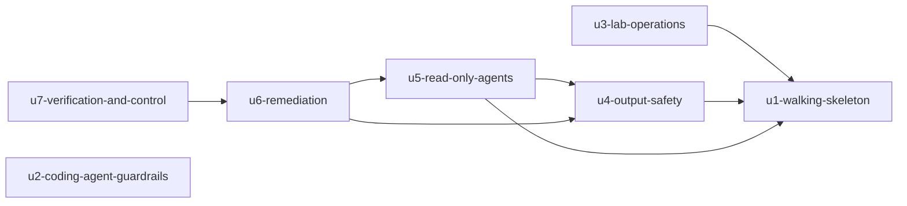

# Unit Dependencies

This file records topology only: which unit's code or tests need which other unit. It sets no build order and no critical path; Delivery Planning chooses the path. Units are defined in `unit-of-work.md`, and the components they group are listed in `inception/domain-design/components.md`.

## Dependency DAG

```yaml
units:
  - name: u1-walking-skeleton
    kind: service
    depends_on: []
  - name: u2-coding-agent-guardrails
    kind: library
    depends_on: []
  - name: u3-lab-operations
    kind: service
    depends_on: [u1-walking-skeleton]
  - name: u4-output-safety
    kind: library
    depends_on: [u1-walking-skeleton]
  - name: u5-read-only-agents
    kind: service
    depends_on: [u1-walking-skeleton, u4-output-safety]
  - name: u6-remediation
    kind: service
    depends_on: [u4-output-safety, u5-read-only-agents]
  - name: u7-verification-and-control
    kind: service
    depends_on: [u6-remediation]
```



<!-- Text fallback: arrows read "depends on". u3 depends on u1. u4 depends on u1. u5 depends on u1 and u4. u6 depends on u4 and u5. u7 depends on u6. u2 has no dependencies and nothing depends on it. -->

## Why each edge exists

| Unit | Depends on | Reason (its code or tests need) |
|---|---|---|
| u3-lab-operations | u1-walking-skeleton | The Terraform resources it rebuilds, tears down and budgets |
| u4-output-safety | u1-walking-skeleton | The Notifier, the incident ID and the AgentSession hooks it attaches to |
| u5-read-only-agents | u1-walking-skeleton | The session, the ledger, the Gateway and the Rancher target |
| u5-read-only-agents | u4-output-safety | Slack summaries, redacted replay recording and the shared model configuration |
| u6-remediation | u5-read-only-agents | The Investigator's root cause and evidence as input; the session graph |
| u6-remediation | u4-output-safety | Sanitizing PR text and Reviewer comments |
| u7-verification-and-control | u6-remediation | Agent PRs to verify, revert or close; the per-service lock it releases |

u2 has no edges. Its guard and CI checks need nothing from the lab or the agents. The other units' PRs pass through its CI gate once it is merged, but none of their code or tests depends on its code.

## Integration points

| Between | Mechanism | Shape (pinned in Contract Design) |
|---|---|---|
| u1 EventIntake to IncidentLedger | Synchronous call inside the intake Lambda; DynamoDB conditional writes | Incident create, update and attach |
| u1 EventIntake to AgentSession | Asynchronous: AgentCore Runtime invocation | Session start event carrying the incident ID |
| u4 sanitizer to all outbound callers | In-process library call | Sanitize request and result (fail closed) |
| u5 and u6 agents to AgentSession | In-process calls within one runtime | Structured agent result per role (ADR-007) |
| u5, u6 and u7 agents to ToolGovernance | AgentCore Gateway (MCP) with Cedar policy | Tool calls and denials |
| u7 EventIntake to AgentSession | Asynchronous: Verifier session start from the merge webhook | Verifier start event carrying the incident ID and the merge commit |
| u2 GuardrailCiGate to every PR | GitHub required checks | Check results on the PR |

## Units that can be built at the same time

These sets have no dependency path between their members:
- {u1, u2}
- {u2, u3, u4}
- {u3, u4}
- {u2, u5}, also with u3
- {u2, u3, u6}
- {u2, u3, u7}

Several orderings of the whole DAG are valid; Delivery Planning picks one.

## Walking skeleton

u1-walking-skeleton is the integrated slice that runs end to end on its own: alert, intake, incident record, session start, one Rancher read. It depends on no other unit, so it can run before every later unit. u2 is also independent and can be built alongside it.
